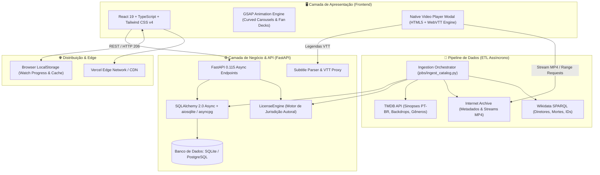
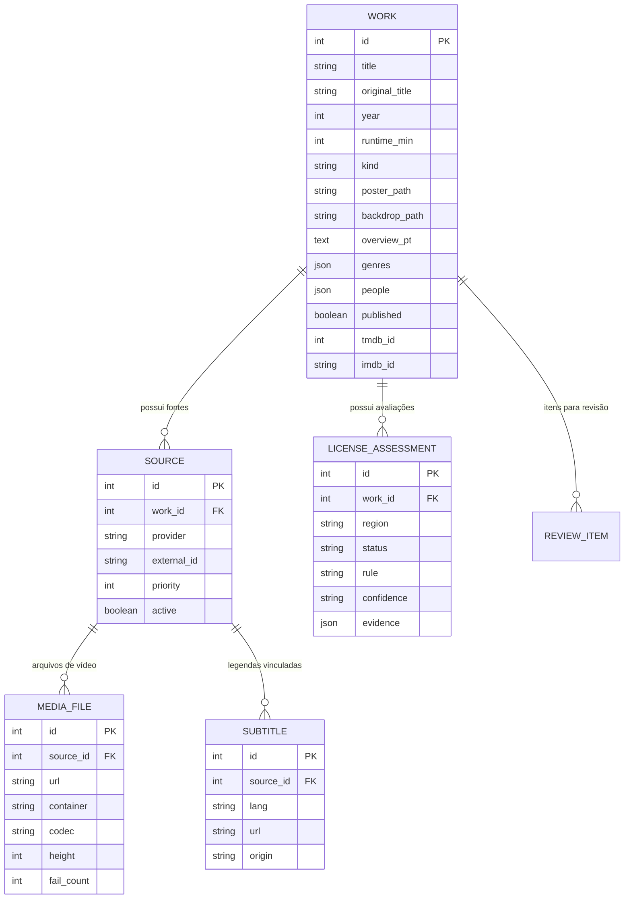

<div align="center">

# 📽️ Lumière
### Plataforma Editorial de Streaming & Preservação do Cinema Clássico em Domínio Público (1895–1955)

[](https://react.dev/)
[](https://www.typescriptlang.org/)
[](https://fastapi.tiangolo.com/)
[](https://www.python.org/)
[](https://www.sqlalchemy.org/)
[](https://tailwindcss.com/)
[](https://docs.pytest.org/)
[](LICENSE)

<br />

**Uma cinemateca digital completa com cópias restauradas, player HTML5 nativo, zero anúncios e auditoria determinística de direitos autorais.**

[Explorar Funcionalidades](#-funcionalidades-implementadas) • [Decisões Técnicas](#-decisões-técnicas--arquitetura) • [Pipeline ETL](#-pipeline-de-dados--ingestão-etl) • [Rodando Localmente](#-como-rodar-o-projeto) • [Guia de Deploy](#-guia-de-deploy-passo-a-passo)

</div>

---

## 🌟 Sobre o Projeto

O **Lumière** é uma plataforma de streaming sob demanda e arquivo digital dedicada ao resgate, curadoria e difusão das obras-primas da Era de Ouro e do Cinema Mudo (1895–1955). 

Mais de 80% dos filmes do início do século XX encontram-se dispersos em acervos públicos desestruturados, sem legendagem moderna em português, sem fichas técnicas unificadas e sujeitos a indefinições jurídicas de direitos autorais. 

O Lumière resolve esses gargalos integrando:
1. **Curadoria Editorial & Catalogação:** Mais de 600 obras históricas catalogadas com pôsteres em alta definição, metadados enriquecidos, contexto histórico e sinopses em português.
2. **Motor Determinístico de Direitos Autorais (`LicenseEngine`):** Avaliação de conformidade legal baseada na jurisdição do espectador (ex: Brasil Lei nº 9.610/98 Art. 44, EUA 95 anos/pré-1931 e União Europeia Vida+70).
3. **Player Audiovisual Nativo:** Reprodução direta em HTML5 com streaming em blocos (`HTTP 206 Partial Content`), seleção de resolução em tempo real, suporte dinâmico a legendas WebVTT e persistência de progresso de reprodução.
4. **Arquitetura Resiliente & Offline-First:** Camada de contingência no frontend que garante navegabilidade contínua mesmo durante cold-boots de APIs em nuvem gratuita.

---

## 🏗️ Arquitetura do Sistema



---

## 🎯 Decisões Técnicas & Trade-offs

### 1. Backend: FastAPI + SQLAlchemy 2.0 Assíncrono
* **Por que FastAPI?** O streaming de metadados, manifestos de reprodução e proxy de legendas sob demanda requerem baixa latência e concorrência elevada. O ecossistema assíncrono do FastAPI baseado em ASGI (`Starlette` + `Uvicorn`) supera backends síncronos convencionais (como Flask ou Django padrão), eliminando o bloqueio de threads durante requisições de I/O de rede externas (TMDB, Internet Archive, Wikidata).
* **Por que SQLAlchemy 2.0 Async + Pydantic v2?** Utilização de `selectinload` para evitar o clássico problema de consulta $N+1$ ao carregar relacionamentos complexos (`Work` -> `Sources` -> `MediaFiles` -> `Subtitles` -> `LicenseAssessments`). Compatibilidade nativa tanto com `aiosqlite` (para zero-configuração em desenvolvimento local) quanto com `asyncpg` (para PostgreSQL robusto em produção).

### 2. Motor Determinístico de Direitos Autorais (`LicenseEngine`)
Um dos maiores diferenciais técnicos e jurídicos do projeto:
* **Jurisdição Brasileira (Lei nº 9.610/1998, Art. 44):** Para obras audiovisuais no Brasil, o prazo de proteção patrimonial é de 70 anos contados a partir de 1º de janeiro do ano subsequente ao da publicação. Em 2026, filmes divulgados até **1955** encontram-se rigorosamente em domínio público irrestrito.
* **Jurisdição Norte-Americana (US Copyright Office):** Aplicação da regra de 95 anos após a publicação (obras anteriores a 1931 já expiradas), combinada com verificação via Wikidata/SPARQL de ausência de renovação cadastral para filmes lançados entre 1931 e 1963.
* **União Europeia / Convenção de Berna:** Regra da vida do último coautor sobrevivente (diretor, roteirista ou compositor) + 70 anos.
* **Auditoria em Tempo Real:** Cada manifesto de reprodução devolve a justificativa legal, a regra invocada, o nível de confiança (`high`, `medium`) e a evidência documental com timestamp de avaliação.

### 3. Pipeline ETL Assíncrono (`jobs/ingest_catalog.py`)
* **Descoberta via Wikidata SPARQL:** Consulta direta ao grafo de conhecimento da Wikimedia filtrando produções audiovisuais históricas lançadas até 1955 vinculadas a identificadores do Internet Archive ou IMDb.
* **Inspeção de Mídia e Validação de Streams:** Conexão à API de metadados do Internet Archive para mapeamento de arquivos `.mp4`, detecção de resolução (`height`: 1080p, 720p, 480p), formatos de áudio e extração de legendas.
* **Enriquecimento Cultural com TMDB:** Tradução e localização automática de títulos, busca de sinopses originais em português do Brasil (`pt-BR`), taglines e cartazes cinematográficos de alta fidelidade.
* **Deduplicação Inteligente:** Prevenção de duplicatas cruzando chaves de `archive_id`, `tmdb_id` e `imdb_id`.

### 4. Frontend: React 19, TypeScript, Tailwind CSS v4 & GSAP
* **Tipagem Estrita com TypeScript:** Interfaces compartilhadas para manifestos de streaming, opções de bitrate, legendas e facetas agregadas.
* **Experiência Visual Imersiva:** Direção de arte editorial inspirada em publicações de cinema europeu (tipografia clássica, paleta dourado/âmbar e noir). Uso de **GSAP** para carrosséis curvados tridimensionais (`HeroCurvedCarousel`) e leques interativos de épocas (`EraFanDeck`).
* **Resiliência e Fallback Graceful:** O módulo `api.ts` implementa fallback automático com catálogo curado interno. Caso a API em nuvem esteja em processo de cold-boot (comum em tiers gratuitos como Render), o usuário nunca se depara com telas quebradas ou erros 500 — a interface carrega instantaneamente e reconecta de forma transparente.

### 5. Player Audiovisual Nativo (`LumierePlayerModal`)
* **Streaming sem DRM proprietário:** O player utiliza a tag `<video>` nativa do HTML5 consumindo arquivos MP4 estáticos hospedados em clusters do Internet Archive através de requisições de intervalo (`HTTP 206 Partial Content`). Isso garante seek instantâneo sem necessitar de servidores HLS dedicados com transcodificação pesada.
* **Engine Customizada de Legendas WebVTT:** Parser próprio de WebVTT/SRT com suporte a sobreposição customizada, evitando inconsistências visuais entre navegadores distintos (Safari, Chrome, Firefox).
* **Controle Total via Teclado:** Espaço (Play/Pause), Setas Esquerda/Direita (Seek ±10s), M (Mute), F (Fullscreen) e Esc (Fechar).
* **Persistência de Progresso:** Salva o timestamp exato assistido via `localStorage`, permitindo retomar a sessão de onde parou.

---

## ✨ Funcionalidades Implementadas

- [x] **Catálogo com Mais de 600 Obras:** Navegação fluida por clássicos do cinema silencioso, expressionismo alemão, suspense noir, comédias clássicas e ficção científica primitiva.
- [x] **Filtros Facetados e Paginação Real em SQL:** Busca por título, filtragem dinâmica por gênero (Drama, Terror, Comédia, Romance, Mistério) e décadas (Pré-1920, 1920, 1930, 1940, 1950–1955).
- [x] **Player de Vídeo Profissional:**
  - Troca de resolução em tempo real (1080p Full HD, 720p HD, 480p SD).
  - Controle de velocidade de reprodução (0.75x a 1.5x).
  - Legendas em português e inglês sincronizadas.
  - Indicador de status de Domínio Público e conformidade com a Lei nº 9.610/98.
- [x] **Minha Lista & Favoritos:** Gerenciamento local de títulos favoritos sem fricção de cadastro obrigatório.
- [x] **Landing Page Editorial:** Apresentação histórica do projeto, timeline das eras do cinema e banner interativo dos Irmãos Lumière.
- [x] **Suíte de Testes Automatizados:** Testes de integração assíncronos com Pytest cobrindo catálogo, streaming, integridade de rotas e o motor de licenças.

---

## 🗄️ Modelo de Dados



---

## 🔌 Documentação da API

A API conta com documentação interativa OpenAPI gerada automaticamente em `/docs` (Swagger UI) e `/redoc`.

| Método | Rota | Descrição |
|---|---|---|
| `GET` | `/healthz` | Health check da API para monitoramento e orquestradores em nuvem |
| `GET` | `/v1/play/catalog` | Lista obras em domínio público com paginação, busca textual e filtros |
| `GET` | `/v1/play/facets` | Retorna métricas e contagens agregadas de filmes por gênero e década |
| `GET` | `/v1/play/works/{id}/stream` | Retorna manifesto de streaming seguro (streams MP4, legendas e legalidade) |
| `GET` | `/v1/play/subtitles/{id}.vtt` | Endpoint proxy de legendas convertidas em tempo real para WebVTT (UTF-8) |

---

## 🧪 Qualidade de Código & Testes

O projeto segue padrões rigorosos de qualidade, tipagem estática e testes unitários/integração:

```bash
# Executando a suíte de testes assíncronos no backend
cd backend
python -m pytest -v

# Saída esperada:
# tests/test_api_play.py .                                         [ 16%]
# tests/test_health.py .                                           [ 33%]
# tests/test_license_engine.py ....                                [100%]
# ======================== 6 passed in 4.13s =========================
```

No frontend:
```bash
cd frontend
npm run type-check   # Validação estrita do compilador TypeScript (0 erros)
npm run lint         # Análise estática com ESLint
npm run build        # Build otimizado de produção via Vite
```

---

## 🚀 Como Rodar o Projeto

### Pré-requisitos
* **Node.js** 20+ e **npm**
* **Python** 3.12+ (ou Docker)
* **Git**

### Opção 1: Via Docker Compose (Mais Rápido)
```bash
# Clone o repositório
git clone https://github.com/GabrielVSL/Lumiere.git
cd Lumiere

# Suba a aplicação completa (Backend + Frontend)
docker compose up --build
```
Acesse a aplicação em `http://localhost:3000` e a documentação da API em `http://localhost:8000/docs`.

---

### Opção 2: Execução Manual

#### 1. Configurando o Backend (FastAPI)
```bash
cd backend

# Criar ambiente virtual
python -m venv .venv

# Ativar o ambiente virtual:
# Windows (PowerShell):
.\.venv\Scripts\Activate.ps1
# Linux / macOS:
source .venv/bin/activate

# Instalar dependências
pip install -r requirements.txt

# Iniciar o servidor Uvicorn (porta 8000)
uvicorn app.main:app --reload --port 8000
```
> O banco de dados SQLite (`lumiere.db`) é criado e populado automaticamente na primeira inicialização (`auto-seed`).

#### 2. Configurando o Frontend (React + Vite)
```bash
cd frontend

# Instalar pacotes
npm install

# Iniciar servidor de desenvolvimento Vite (porta 5173)
npm run dev
```
Abra o navegador em `http://localhost:5173`.

---

## ☁️ Guia de Deploy Passo a Passo

O Lumière foi estruturado para suportar deploy gratuito em minutos:

### 1. Subindo o Backend no Render (Grátis)
1. Crie uma conta no [Render](https://render.com/).
2. Clique em **New +** > **Web Service**.
3. Conecte seu repositório GitHub `GabrielVSL/Lumiere`.
4. Configure as seguintes opções:
   * **Root Directory:** `backend`
   * **Environment:** `Python 3`
   * **Build Command:** `pip install -r requirements.txt`
   * **Start Command:** `uvicorn app.main:app --host 0.0.0.0 --port $PORT`
5. Em **Advanced** > **Environment Variables**, adicione:
   * `DATABASE_URL`: `sqlite+aiosqlite:///./lumiere.db` (ou URL do seu banco PostgreSQL)
   * `CORS_ORIGINS`: `["http://localhost:5173","https://sua-url-da-vercel.vercel.app"]`
6. Clique em **Create Web Service**. Ao finalizar o build, você receberá uma URL pública (ex: `https://lumiere-api.onrender.com`).

---

### 2. Subindo o Frontend na Vercel (Grátis)
1. Crie uma conta ou faça login na [Vercel](https://vercel.com/).
2. Clique em **Add New...** > **Project**.
3. Importe o repositório `GabrielVSL/Lumiere`.
4. Configure o projeto:
   * **Framework Preset:** `Vite`
   * **Root Directory:** Selecione e edite para `frontend` (clique em *Edit* e aponte para `frontend`).
   * **Build Command:** `npm run build`
   * **Output Directory:** `dist`
5. Em **Environment Variables**, adicione:
   * `VITE_FASTAPI_URL`: A URL do seu backend no Render com o prefixo `/v1` (ex: `https://lumiere-api.onrender.com/v1`).
6. Clique em **Deploy**. Em menos de 1 minuto seu site estará no ar com HTTPS e CDN global!

---

## 📂 Estrutura de Diretórios

```
Lumiere/
├── docker-compose.yml          # Orquestração de containers local
├── .gitignore                  # Regras de exclusão globais
├── README.md                   # Documentação mestre do projeto
│
├── backend/                    # Core da API & Pipeline de Dados
│   ├── app/
│   │   ├── api/v1/play.py      # Endpoints REST (Catálogo, Stream, Facetas, Legendas)
│   │   ├── clients/            # Clientes HTTP (Internet Archive, TMDB, Wikidata SPARQL)
│   │   ├── core/               # Configurações de ambiente e conexão com BD
│   │   ├── models/play.py      # Entidades SQLAlchemy (Work, Source, MediaFile, etc.)
│   │   ├── schemas/play.py     # Schemas de validação e serialização Pydantic
│   │   ├── services/           # Motor determinístico de direitos autorais (LicenseEngine)
│   │   └── main.py             # Instância do FastAPI, Lifespan e Middleware CORS
│   ├── jobs/                   # Scripts de Ingestão em lote e Seed curado
│   ├── tests/                  # Testes automatizados assíncronos com Pytest
│   ├── Dockerfile              # Imagem Docker de produção do backend
│   ├── Procfile                # Configuração para deploy em PaaS (Render / Railway)
│   ├── requirements.txt        # Dependências Python travadas
│   └── .env.example            # Template de variáveis de ambiente do backend
│
└── frontend/                   # Interface Web Moderna (SPA)
    ├── api/                    # Serverless TMDB Express proxy (Vercel)
    ├── src/
    │   ├── components/         # Componentes React (Player, Landing, Catálogo, Layout)
    │   │   ├── landing/        # Carrosséis GSAP, FanDeck e Hero da Landing Page
    │   │   ├── player/         # Player de vídeo HTML5 customizado com legendas WebVTT
    │   │   └── LumierePlay.tsx # Navegador do acervo com filtros e paginação
    │   ├── context/            # Contexto de autenticação e preferências
    │   ├── services/api.ts     # Cliente de API com fallback offline automático
    │   └── types/              # Definições de tipagem TypeScript
    ├── Dockerfile              # Imagem Docker multi-stage com Nginx
    ├── vercel.json             # Regras de reescrita e roteamento SPA na Vercel
    └── package.json            # Scripts e dependências do frontend
```

---

## 👨‍💻 Autor

Desenvolvido por **Gabriel**  
* GitHub: [@GabrielVSL](https://github.com/GabrielVSL)  
* LinkedIn: [Gabriel](https://www.linkedin.com/)

---

## 📜 Licença

Este projeto está licenciado sob a Licença MIT — consulte o arquivo [LICENSE](LICENSE) para obter mais detalhes. As obras audiovisuais disponibilizadas na plataforma pertencem ao Domínio Público conforme legislação vigente aplicável.
